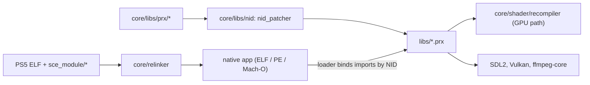

# Code map: AnyPS5 (fork)

- Repo: iannitram/AnyPS5, a fork of boykopovar/AnyPS5 (C++20 / CMake, GPL-2.0-only).
- Kind: static relinker plus reimplemented PS5 system libraries (no emulation). It converts a PS5 executable into a native Linux ELF, Windows PE or macOS Mach-O that calls native implementations of the system libraries.
- Integration branch: `main` (merge commits only). Describes commit: 1c729f497 (2026-10-28). The last code change on `main` is the merge `e7c0343f5` (2026-10-26); commits after it are fork docs only.
- Upstream: `boykopovar/AnyPS5` (`upstream/main`). This fork does not post to it.

## Layout

| Path | What it owns |
|---|---|
| `core/relinker/` | The relinker tool. `main.cpp` runs the steps; `cli/` arguments; `io/` readers and writers; `domain/` shared types; `codegen/` `--to-intel` lowering of AMD-only instructions; `elfpatcher/` Linux ELF, Windows PE and macOS Mach-O output (shared entry stubs and layout builders, per-OS patchers and guest-module writers); `relinker/` import reading, NID filtering, game patches (`src/patching/GamePatch.cpp`), conversion pipeline and its tests; `wasm/` browser build. |
| `core/libs/prx/` | One directory per PS5 system library (about 370, named `libSce*`, plus `libc`, `libkernel`). Each builds as a shared library whose exports are later renamed to NIDs. Largest: `libc`, `libkernel` (Pthread, File, System, Module/DynamicLoader), `libSceAgc*` (GPU command buffers), `libSceLibcInternal`, `libScePosixForWebKit`. |
| `core/libs/nid/` | `nid_patcher`: computes NIDs (SHA-1 of the name) and rewrites exports in ELF, PE and Mach-O; Python tests for layout, hash tables, symbol versions. |
| `core/libs/allocator/` | Windows mimalloc import-order fix (`PeImportFirst`) and runtime heap. |
| `core/libs/tests/` | Native runtime tests for the libraries (about 735 files), registered with ctest. |
| `core/libs/{HitLog,SceShaders,SceTypes}.hpp` | Shared headers for the library layer. |
| `core/shader/recompiler/` | RDNA shader recompiler to SPIR-V: `RdnaDecoder/`, `ControlFlow/`, `IntermediateRepresentation/`, `Optimization/`, `Translation/`, `SpirvBackend/`, disk cache (`ShaderDiskCache`, `ShaderCachePack`), `tests/`. |
| `core/Decoder/{Jpeg,Png}/` | Image decoders used by the libraries (JPEG via libjpeg-turbo). |
| `3rdparty/` | Git submodules (see Open-source pieces). |
| `cmake/` | Build helpers: `SystemDeps`, `Opus`, `Jxr`, `Tracy`, `ZArchive`, Windows exit shims. |
| `demo/web/` | Browser converter front end (`app.mjs`, `archive.mjs`, `batch.mjs`, `index.html`) with Node tests in `demo/web/tests/`. |
| `tools/` | Python and shell dev tools with tests in `tools/tests/`: `check_conventions.py`, `check_compile.py`, `check_main_sync.py`, `check_skips.py`, `check_test_registration.py`, `compile_slot.sh`, `pr_overlap.py`, `pr_labels.py`, `select_tests.py`, `stubgen.py`, `progress.py` and `progress_history.py`, `performance_compare.py`, `trace_digest.py`, `symbolize_samples.py`, `package_release.py`, `prepare_release_notes.py`, `build_web.py`, `test_web.py`, `unwrap_self.py`, `nid_names.py`, `import_audit.py`, `audit_dump.py`, `configure_seed.py`, `env_reference.py`, `debt_split.py`, `suggest_patches.py`, `pad_input.py`, `pad_timeline.py`, `run_job_manager_reference.py`, `rdna_isa.txt`, `input-mapper/` (Node app, own CI workflow), `hw-oracle/` (Python and C hardware-oracle runner). |
| `docs/user/` | `USAGE.md`, `INPUT_MAPPING.md`. |
| `docs/dev/` | `ARCHITECTURE.md`, `BUILD.md`, `CONVENTIONS.md`, `ENVIRONMENT.md`, `GAME_TESTING.md`, `HW_ORACLE.md`, `PROGRESS.md`, `TRACING.md`, `TechnicalDebt.md`, and `debt/<library>.md` (about 250 known-gap files). |
| `AGENTS.md`, `CONTRIBUTING.md` | Contribution rules (Conventional Commits, no code comments, throw rather than fake success). |
| `.github/` | Workflows, issue and PR templates, labeler. |

## How it fits together



- Entry point of the tool: `core/relinker/main.cpp`. Order: optional `--to-intel` lowering, `RelinkerPipeline` (read imports by NID, check syscalls, drop unused NIDs, build the dynamic section), `GuestModuleBuilder` for bundled modules, then `LinuxElfPatcher` / `WindowsPePatcher` / macOS image writer. Game patch files (a TOML subset) are applied to the bytes first.
- Runtime: the converted program imports functions by NID; the OS loader binds them to the patched `.prx` shared libraries from `core/libs/prx`. Guest code allocates from a guest arena (`libc/src/GuestHeap.cpp`).
- Graphics: `libSceAgc*` builds command buffers, the shader recompiler produces SPIR-V, and Vulkan presents through SDL2.
- Unsupported behavior throws `std::runtime_error`; unimplemented exports call `NotImplemented_nid_no_patch`.
- Full detail: `docs/dev/ARCHITECTURE.md`.

## Where our work is

`git log upstream/main..HEAD` shows about 102 non-merge commits (46 fix, 44 feat, the rest docs, tests and pipeline files) plus many merge commits; `git diff upstream/main...HEAD` is 100 files, +13,647 / -40. Our merge-base with upstream is `18ef6be0c`; upstream was about 2,060 commits (merges included) ahead at this snapshot, so a `sync/upstream-*` branch is normally in flight.

| Area touched | Share of changed files |
|---|---|
| `core/libs/tests/` (new tests for our library work) | about 37% |
| `core/libs/prx/libc/src/` (exceptions, regex limits, libm and complex exports, GuestHeap-adjacent fixes) | about 37% |
| `core/libs/prx/libSceLibcInternal/` (glob, descriptor printf, file tree walk, error reports) | about 6% |
| `core/libs/prx/libkernel/` (per-thread pending signals, setitimer/SIGALRM, pthread/posix, file, system) | about 9% |
| `core/libs/prx/libScePosixForWebKit/` | about 3% |
| `docs/dev/debt/`, `TechnicalDebt.md` | about 3% |

The remaining files are the fork's own docs (`PIPELINE.md`, `SPEC.md`, `AGENTS.fork.md`, `CHANGELOG.md`, this map). Nothing under `core/relinker`, `core/shader`, `demo` or `tools` differs from upstream in our commits. All of our work is POSIX/libc-layer library behavior and its tests.

## Build and test

Commands as `docs/dev/BUILD.md` states them:

```sh
# relinker only (no submodules; runs on Linux, Windows, macOS incl. Apple silicon)
cmake -S . -B build-relinker -G Ninja -DCMAKE_BUILD_TYPE=Release -DANYPS5_RELINKER_ONLY=ON -DBUILD_TESTING=ON
cmake --build build-relinker --parallel
ctest --test-dir build-relinker --output-on-failure

# full build
git submodule update --init --recursive
cmake -S . -B build -G Ninja -DCMAKE_BUILD_TYPE=Release -DCMAKE_C_COMPILER=gcc -DCMAKE_CXX_COMPILER=g++
cmake --build build --parallel
cmake --build build --target libs --parallel   # libraries are EXCLUDE_FROM_ALL
```

Needs CMake 3.22.1+, Ninja, C++20, x86-64. Before pushing: `python3 tools/check_conventions.py --base origin/main`; before a PR: `python3 tools/pr_overlap.py --branch <branch>`. Web converter: `python3 tools/test_web.py --build build-wasm`.

CI (`.github/workflows/build.yml`): `eligibility` (decides which jobs a change reaches), `relinker` (matrix of hosts), `relinker-asan`, `register-context`, `write-watch`, `linux` (self-hosted runner labeled `anyps5`), `windows` (windows-latest, WinLibs GCC). Other workflows: `web-tests`, `windows-msys2`, `release`, `pages`, progress reports, label and PR-intake automation, `conventions`.

## Mac / PC / Linux

- Linux x86-64: the primary full target; self-hosted CI builds and tests it. R04: this repo is a Linux-check repo, so a Linux machine must build and verify before a sync PR merges.
- Windows x86-64: full build with MinGW-w64 GCC (POSIX threads); CI job `windows` and `windows-msys2`.
- macOS: only the relinker-only build is supported (`-DANYPS5_RELINKER_ONLY=ON`); the runtime libraries are not built there, and `Aps5StartGuest` has no macOS implementation. CI covers macOS in the relinker matrix (macos-latest clang++, plus x86_64), and the `register-context` and `write-watch` jobs run on macOS runners (macos-15, macos-15-intel).
- Platform-specific code lives in `core/relinker/elfpatcher/src/{general,linux,windows,macos}` and in `cmake/` Windows shims.

## Open-source pieces

Submodules in `.gitmodules`: SDL2 (window, input, audio), Vulkan-Headers, SPIRV-Headers, SPIRV-Tools and glslang (shader validation/compile), VulkanMemoryAllocator, ffmpeg-core (KytyPS5 fork, media decode), opus, ogg, vorbis, vgmstream, LibAtrac9 (audio codecs), freetype, stb, libjpeg-turbo, jxrlib, mbedtls, zstd, ZArchive, nghttp2, libusb-cmake, mimalloc (optional Windows allocator), tracy (profiling).
